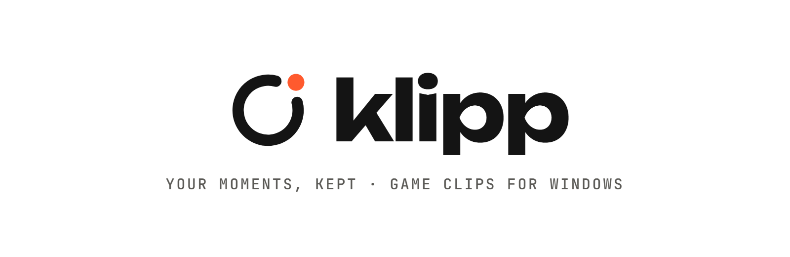
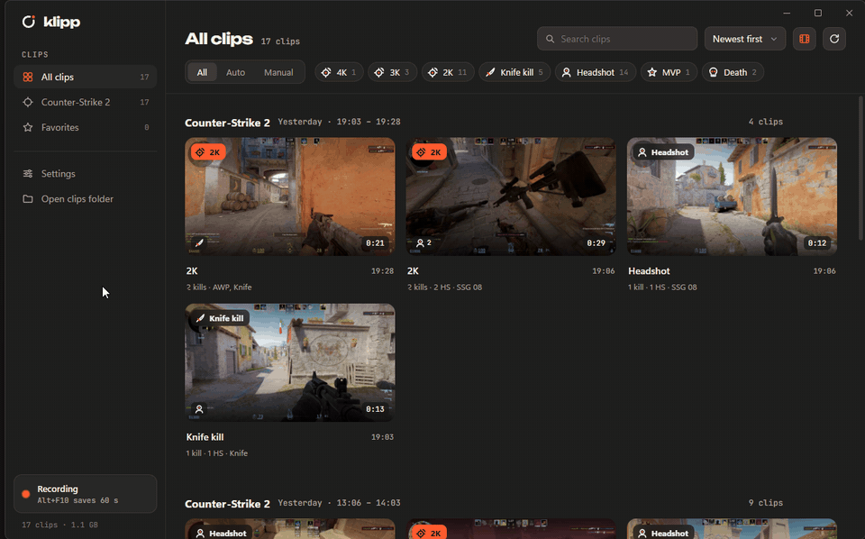
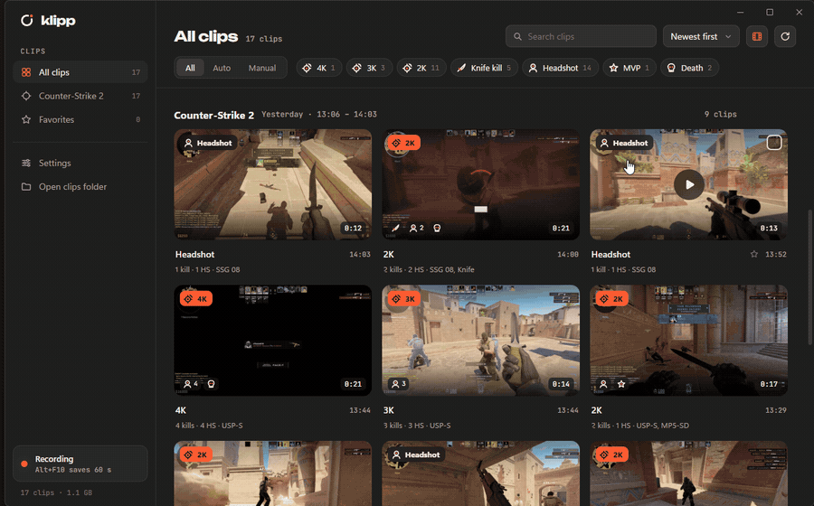
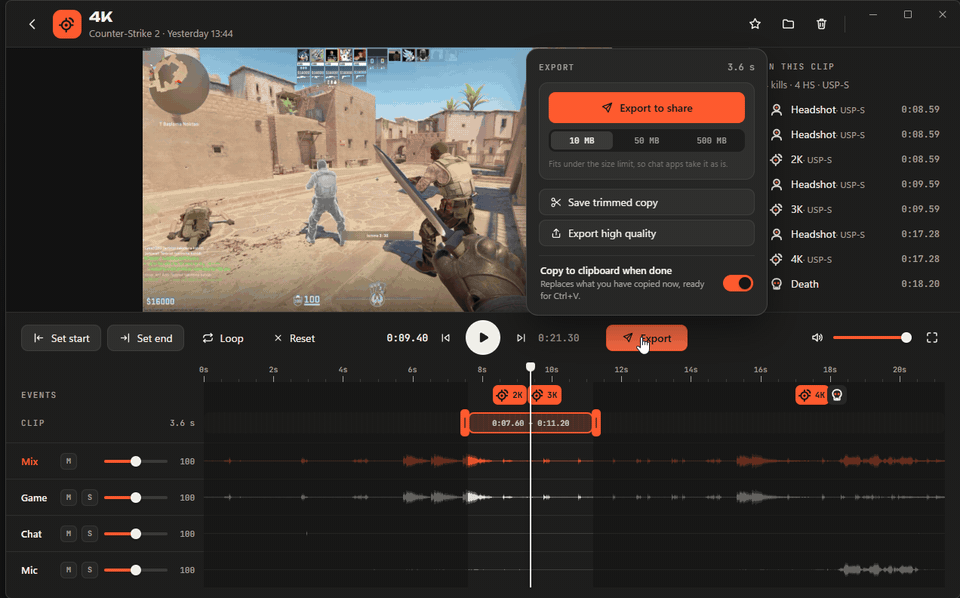

<p align="center">
  <picture>
    <source media="(prefers-color-scheme: dark)" srcset="assets/readme/banner-dark.png">
    
  </picture>
</p>

<p align="center">
  A light, always-on clip recorder for Windows.<br>
  Press a key and the last moments are saved, or let it catch your headshots and multi-kills on its own.
</p>

<p align="center">
  <a href="#install">Install</a> ·
  <a href="#features">Features</a> ·
  <a href="ROADMAP.md">Roadmap</a> ·
  <a href="docs/BUILDING.md">Build from source</a>
</p>

<p align="center">
  
</p>

## Why Klipp

Replay recorders run all day, so they should cost nothing while they do. Klipp keeps your last moments in memory, encodes on your graphics card and stays the same size the longer it runs: in an 8-hour test its memory moved by less than 2 MB after warming up, at about 0.3 % CPU.

No account, no ads, no telemetry. Your clips stay on your PC.

## Features

- **Replay buffer.** The last 10 seconds to 5 minutes are always ready. **Alt+F10** saves them in a blink, from anywhere, even in fullscreen games. Press it a few times in a row and you get one clip with every press marked.
- **Auto-clips for Counter-Strike 2.** Headshots, 2K to aces, knife and Zeus kills are saved by themselves, using Valve's official Game State Integration. Nothing touches the game, so it's safe with VAC.
- **Separate audio tracks.** Game, chat and mic can each be their own track, so a loud teammate can be turned down after the fact.
- **A library that reads like a history.** Clips are filed per game and grouped into play sessions by time and map, with event icons and filters.
- **An editor that stays out of the way.** Waveforms for every track, event markers, trim handles that snap, and trims and levels that are remembered per clip.
- **Share in a click.** Export under 10, 50 or 500 MB for chat apps, a high quality copy, or a lossless trim. It can go straight to your clipboard.

<p align="center">
  
</p>

<p align="center">
  
</p>

## Install

Klipp 0.1 is built from source; ready-made downloads are coming.

**You need:** Windows 11, an NVIDIA graphics card (AMD and Intel are on the [roadmap](ROADMAP.md)), [Rust](https://rustup.rs), [Node.js 22](https://nodejs.org) and the Visual Studio Build Tools. [docs/BUILDING.md](docs/BUILDING.md) has the one-line installs.

```powershell
git clone https://github.com/alonsy/klipp
cd klipp
.\scripts\fetch-ffmpeg.ps1      # FFmpeg (LGPL), checked against its checksum
.\scripts\install.ps1           # builds Klipp and installs it for your user
```

Klipp starts recording in the tray right away; open it from the Start Menu. Add `-Autostart` to start recording with Windows. To remove it, run `.\scripts\uninstall.ps1` (your clips stay).

> **Graphics cards:** recording uses AV1, which needs a GeForce RTX 40-series or newer. On older NVIDIA cards, switch to H.264 in **Settings → Video**.

## Good to know

- **CS2 auto-clips** need one restart of CS2 after the first run, so it picks up Klipp's integration file.
- **The save sound** plays on your default speakers or headset. If that's also what Klipp records, pick another device in **Settings → Sounds** so the sound doesn't end up in your next clip.
- **Clips** go to `Videos\Klipp` by default, one folder per game. Klipp keeps its notes about them (markers, thumbnails, trims) in a hidden `.klipp` folder there.

<p align="center">
  
</p>

## Roadmap

More games, AMD and Intel encoders, and optional self-hosted cloud backup are next. See [ROADMAP.md](ROADMAP.md), and our promises: no ads, ever, and always open source.

## License

[MIT](LICENSE). Klipp uses [FFmpeg](https://ffmpeg.org) under the LGPL 2.1, as separate libraries next to the program.
