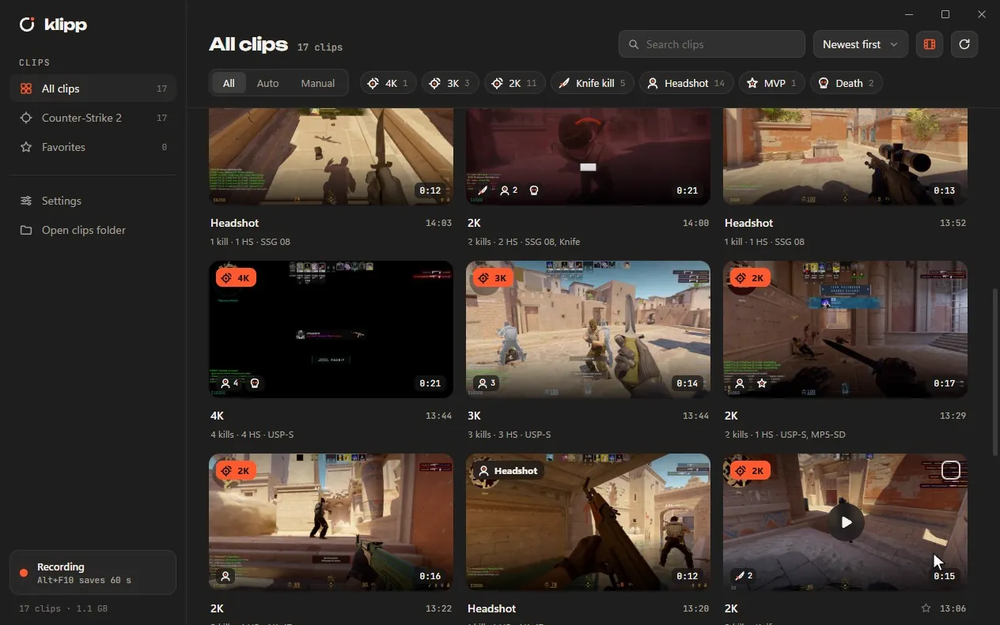

  <picture>
    <source media="(prefers-color-scheme: dark)" srcset="assets/readme/banner-dark.png">
    
  </picture>

  A light, always-on clip recorder for Windows. 
  Press a key and the last moments are saved, or let it catch your headshots and multi-kills on its own.

  <a href="https://klipp.dev">klipp.dev</a> ·
  <a href="#install">Install</a> ·
  <a href="#features">Features</a> ·
  <a href="ROADMAP.md">Roadmap</a> ·
  <a href="docs/BUILDING.md">Build from source</a>

  

## Why Klipp

Replay recorders run all day, so they should cost nothing while they do. Klipp keeps your last moments in memory, encodes on your graphics card and stays the same size the longer it runs: in an 8-hour test its memory moved by less than 2 MB after warming up, at about 0.3 % CPU.

No account, no ads, no telemetry. Your clips stay on your PC.

## Features

- **Replay buffer.** The last 10 seconds to 5 minutes are always ready. **F8** (Alt+F8 on laptops) saves them in a blink, from anywhere, even in fullscreen games. Press it a few times in a row and you get one clip with every press marked.
- **Auto-clips for Counter-Strike 2, League of Legends and Rocket League.** Your best moments are saved by themselves, from what each game officially shares: Valve's Game State Integration, Riot's Live Client Data API and Psyonix's Stats API. Klipp never reads a game's memory or injects anything.
- **Separate audio tracks.** Game, chat and mic can each be their own track, so a loud teammate can be turned down after the fact, or left out when you share. Without an audio mixer, Discord can get its own Chat track (experimental).
- **A library that reads like a history.** Clips are filed per game and grouped into play sessions by time and map, with event icons and filters.
- **An editor that stays out of the way.** Waveforms for every track, event markers, trim handles that snap, and trims and levels that are remembered per clip.
- **Share in a click.** Export under 10, 50 or 500 MB for chat apps, a high quality copy, or a lossless trim. It can go straight to your clipboard.
- **Indicators on top of your game, if you want them.** "Auto-clips ON" when a CS2 match starts, and a small mark when a clip saves. They're a separate window: never in your clips, never touching the game.

  

  

## Install

  

Run **Klipp-Setup.exe**. It installs for your user in a few seconds (no admin needed) and opens Klipp, which checks what your PC can record and asks a few questions: your microphone and audio, the video quality, and your save hotkey. Updates arrive in the app with one click.

> The installer isn't signed yet, so Windows may say it protected your PC. Click **More info**, then **Run anyway**. Signed builds are on the way.

**You need** Windows 10 or 11 and graphics from NVIDIA, AMD or Intel, including the graphics built into most processors. Newer chips record AV1 (smaller files): GeForce RTX 40-series and up, Radeon RX 7000 and up, Radeon 700M/800M, Intel Arc and Core Ultra. Others record H.264 automatically.

To build it yourself, see [docs/BUILDING.md](docs/BUILDING.md).
## Good to know

- **CS2 and Rocket League auto-clips** need one restart of the game after installing, so it picks up Klipp's settings.
- **The save sound** stays out of your clips by itself. With SteelSeries Sonar, Voicemeeter or another audio mixer, play it on your headset instead (**Settings → Sounds**).
- **Clips** go to `Videos\Klipp` by default, one folder per game. Klipp keeps its notes about them (markers, thumbnails, trims) in a hidden `.klipp` folder there.
- **Uninstalling** (Windows Settings → Apps) removes Klipp and its startup entry. Your clips and settings stay.

  

## Roadmap

More games, recording on the NVIDIA GPU of gaming laptops, and optional self-hosted cloud backup are next. See [ROADMAP.md](ROADMAP.md), and our promises: no ads, ever, and always open source.

## Help out

Found a bug, or want auto-clips for your game? [Open an issue](https://github.com/alonsy/klipp/issues/new/choose); the forms ask for what we need. No GitHub account? Use [klipp.dev/feedback](https://klipp.dev/feedback). Pull requests are welcome too: see [CONTRIBUTING.md](CONTRIBUTING.md).

## Thanks

The save and error sounds are by [@f.inancimen](https://instagram.com/f.inancimen). Thank you!

## License

[MIT](LICENSE). Klipp uses [FFmpeg](https://ffmpeg.org) under the LGPL 2.1, as separate libraries next to the program. "Klipp that" uses [sherpa-onnx](https://github.com/k2-fsa/sherpa-onnx) and its keyword model (Apache 2.0); see `crates/klipp-voice/LICENSES.txt`.

Klipp isn't endorsed by Riot Games and doesn't reflect the views or opinions of Riot Games or anyone officially involved in producing or managing Riot Games properties. Riot Games, and all associated properties are trademarks or registered trademarks of Riot Games, Inc.
